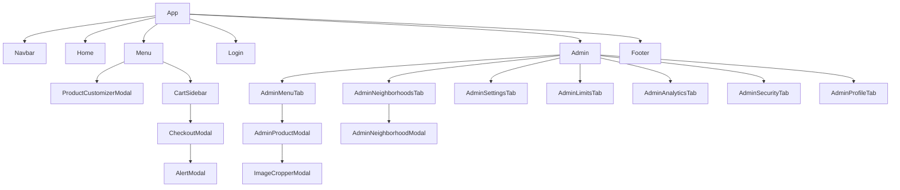

# Prototipo de baja fidelidad por componentes – Antana

Wireframes en ASCII, uno por componente real de `src/`. Sirven como referencia para diseño, QA y nuevas historias de usuario.

## 0. Mapa de componentes



---

## 1. Navbar (`Navbar.jsx`)
```
+--------------------------------------------------------------+
| [LOGO]   Inicio  Menú        Horario · Ubicación · IG · FB   |
|                                                   [🛒 (3)]   |
+--------------------------------------------------------------+
```
- Muestra logo (configurable), horario, redes, botón de carrito con contador.

## 2. Home (`Home.jsx`)
```
+--------------------------------------------------------------+
|  Sabor ANGUS Inigualable                                     |
|  Descripción de marca...                [ VER MENÚ ]         |
+--------------------------------------------------------------+
|  [Hamburguesas] [Salchipapas] [Perros] [Bebidas]  (accesos)  |
+--------------------------------------------------------------+
```

## 3. Menú (`Menu.jsx`)
```
+--------------------------------------------------------------+
| 🔍 Buscar...                                                 |
| [Todas][Hamburguesas][Salchipapas][Perros][Bebidas][Postres] |
+--------------------------------------------------------------+
| HAMBURGUESAS                                                 |
| +-----------+ +-----------+ +-----------+                    |
| |  [img]    | |  [img]    | |  [img]    |                    |
| | Nombre    | | Nombre    | | Nombre    |                    |
| | $ 18.000  | | $ 20.000  | | AGOTADO   |                    |
| | [Agregar] | | [Agregar] | | (bloqueado)|                   |
| +-----------+ +-----------+ +-----------+                    |
+--------------------------------------------------------------+
```
- Agrupado por categoría, búsqueda en tiempo real, estado AGOTADO.

## 4. Personalizador (`ProductCustomizerModal.jsx`)
```
+----------------------------------------+
| [img]  Nombre del producto        [X]  |
| Descripción                            |
|----------------------------------------|
| [ + Salsas ] [ + Ingredientes ]        |
|  ( ) Mayonesa   gratis                 |
|  (x) BBQ        gratis                 |
|  [-] 1 [+] Tocineta       +$ 3.000     |
|----------------------------------------|
| Notas: [ Sin cebolla................ ] |
| Cantidad: [-] 1 [+]                    |
| [ AGREGAR AL CARRITO · $ 21.000 ]      |
+----------------------------------------+
```
- Bebidas: pestaña única `+ Michelados`.

## 5. Carrito (`CartSidebar.jsx`)
```
+---------------------------+
| Tu pedido            [X]  |
|---------------------------|
| 2 x HAMBURGUESA CLÁSICA   |
|   + BBQ, Tocineta         |
|   Nota: sin cebolla       |
|   Subtotal $ 42.000  [🗑] |
|---------------------------|
| Subtotal       $ 42.000   |
| [ CONTINUAR AL PAGO ]     |
+---------------------------+
```

## 6. Checkout (`CheckoutModal.jsx`)
```
+------------------------------------------+
| Finalizar pedido                    [X]  |
| (•) Domicilio   ( ) Recoger en local     |
|------------------------------------------|
| Nombre *      [......................]   |
| Celular *     [__________] (10 dígitos)  |
| Barrio *      [ Selecciona ▼ ]           |
| Dirección *   [......................]   |
| Conjunto/Torre/Apto * [..............]   |
| Pago *        ( ) Efectivo ( ) Nequi ... |
|------------------------------------------|
| ℹ Aviso de operación / demora            |
| Subtotal  $ 42.000                       |
| Domicilio $  5.000                       |
| TOTAL     $ 47.000                       |
| [ ENVIAR PEDIDO POR WHATSAPP ]           |
+------------------------------------------+
```

## 7. AlertModal (`AlertModal.jsx`)
```
+------------------------------+
|  ⚠ ¿Eliminar producto?       |
|  Esta acción no se deshace.  |
|     [Cancelar] [Eliminar]    |
+------------------------------+
```

## 8. Footer (`Footer.jsx`)
```
+--------------------------------------------------------------+
| Logo · Dirección · Horario · [IG] [FB] [WhatsApp]            |
+--------------------------------------------------------------+
```

## 9. Login (`Login.jsx`)
```
+------------------------------+
|          [LOGO]              |
| Correo   [................]  |
| Clave    [................]  |
|        [ INGRESAR ]          |
+------------------------------+
```

## 10. Admin (`Admin.jsx`) y pestañas
```
+---------+----------------------------------------------------+
| ☰       |  <Título de la pestaña>                            |
| Menú    |                                                    |
| Barrios |   (contenido de la pestaña activa)                 |
| Ajustes |                                                    |
| Límites |                                                    |
| Estad.  |                                                    |
| Seguridad|                                                   |
| Perfil  |                                                    |
| Salir   |                                                    |
+---------+----------------------------------------------------+
```

| Pestaña | Archivo | Wireframe resumido |
|---|---|---|
| Menú | `AdminMenuTab.jsx` | Tabla: img · nombre · categoría · precio · [toggle stock] · [✏][🗑] + botón `+ Nuevo` |
| Producto | `AdminProductModal.jsx` | Form: nombre, descripción, precio, categoría, imagen → `ImageCropperModal` (1:1) |
| Barrios | `AdminNeighborhoodsTab.jsx` | Lista: barrio · costo · restringido · [✏][🗑] |
| Barrio | `AdminNeighborhoodModal.jsx` | Form: nombre, precio, restringido, punto de encuentro, alerta personalizada |
| Ajustes | `AdminSettingsTab.jsx` | 3 tarjetas de estado (Normal / Demora / Cerrado) + plantilla WhatsApp con chips `{pedido}` `{total}` |
| Límites | `AdminLimitsTab.jsx` | Por categoría: [toggle activo] + límite numérico |
| Estadísticas | `AdminAnalyticsTab.jsx` | Filtro de fechas · tarjetas (pedidos, ventas) · gráficas · tabla de pedidos |
| Seguridad | `AdminSecurityTab.jsx` | Lista de correos admin + agregar/eliminar |
| Perfil | `AdminProfileTab.jsx` | Branding: logo, galería de logos (máx. 5), título, descripción |
