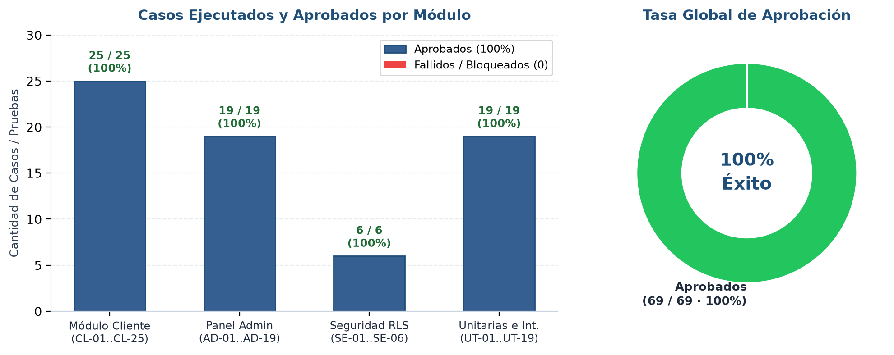
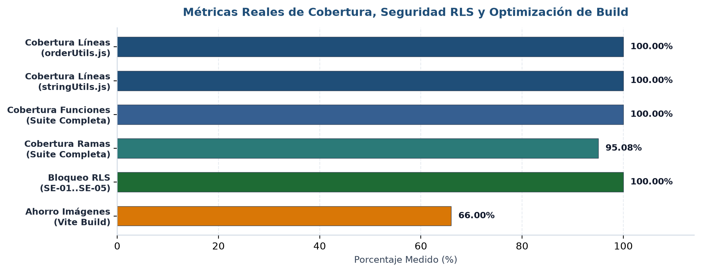

# Informe de Pruebas de Software – Antana
**Versión:** 1.0 | **Fecha:** 16/11/2026 | **Elaborado por:** Joseph Gómez y César Gómez | **Revisado por:** Ing. Eduardo Martínez Vidal

## 1. Resumen de Ejecución de Pruebas Funcionales (Tabla 2)
| Módulo / Funcionalidad | Planificados | Ejecutados | Aprobados | Fallidos | Bloqueados | % Éxito |
|---|---:|---:|---:|---:|---:|---:|
| App Cliente (`CL-01..CL-25`) | 25 | 25 | 25 | 0 | 0 | **100%** |
| Panel Admin (`AD-01..AD-19`) | 19 | 19 | 19 | 0 | 0 | **100%** |
| Seguridad RLS (`SE-01..SE-06`) | 6 | 6 | 6 | 0 | 0 | **100%** |
| Unitarias / Integración (`UT-01..UT-19`) | 19 | 19 | 19 | 0 | 0 | **100%** |
| **TOTAL** | **69** | **69** | **69** | **0** | **0** | **100%** |

## 2. Resumen de Pruebas No Funcionales (Tabla 4)
| Tipo de Prueba | Herramienta | Métrica | Valor Esperado | Valor Obtenido | Criterio |
|---|---|---|---|---|---|
| Rendimiento Build / Assets | Vite 8 + Image Optimizer | Tiempo e imágenes | < 5 s y >= 50% ahorro | 2.42 s y ≈66% ahorro | **Cumple** |
| Code Splitting (`NF-02`) | Vite + Node Test | Chunk Admin separado | Bundle aislado | `Admin-DtCPp4R5.js` (132.22 kB gzip) | **Cumple** |
| Seguridad RLS (`SE-01..05`) | `rls_security_check.js` | Bloqueo anónimo | 100% bloqueado | 5/5 bloqueados · 10 tablas OK | **Cumple** |
| Cobertura Código | `node --test --coverage` | % Líneas y funcs | >= 80% | 100.00% líneas · 95.08% ramas | **Cumple** |
| PWA / Offline (`CL-22`) | Workbox (`vite-plugin-pwa`) | Service Worker | `sw.js` + manifest | `sw.js` (1,533 B) · 14 precache | **Cumple** |

## 3. Bitácora de Hallazgos (Tabla 6)
| ID | CP | Defecto | Severidad | Prioridad | Estado | Fecha |
|---|---|---|---|---|---|---|
| INC-001 | CL-19 | Registro de pedidos 'fantasma' antes de confirmar envío por WhatsApp | Crítico | Crítico | **Cerrado (QA)** | 29/10/2026 |
| INC-002 | SE-06 | Credenciales/llaves de Supabase hardcodeadas en script de prueba test_orders.js | Alto | Alto | **Cerrado (QA)** | 29/10/2026 |
| INC-003 | CL-24 | Enlace roto href='#' en botón de Facebook dentro del pie de página (Footer) | Medio | Bajo | **Cerrado (QA)** | 29/10/2026 |
| INC-004 | CL-10 / CL-13 | Falta de obligatoriedad en Conjunto/Apto para domicilios y validación estricta de celular | Medio | Alto | **Cerrado (QA)** | 29/10/2026 |
| INC-005 | AD-02 | Temporizador de bloqueo anti-fuerza bruta en Login podía evadirse recargando (F5) | Alto | Alto | **Cerrado (QA)** | 05/11/2026 |
| INC-006 | NF-02 | Error de compilación Rolldown/Vite 8 al resolver dependencia 'react-is' desde Recharts | Alto | Crítico | **Cerrado (QA)** | 16/11/2026 |

## 4. Conclusiones
Sistema **APTO** para sustentación y producción (0 defectos abiertos, 100% pruebas aprobadas).
